<a href="https://harun.dev">
  <picture>
    <source media="(prefers-color-scheme: dark)" srcset="assets/banner-dark.svg">
    
  </picture>
</a>

  <a href="https://harun.dev"><b>harun.dev</b></a> ·
  <a href="https://harun.dev/blog">Blog</a> ·
  <a href="https://harun.dev/products">Products</a> ·
  <a href="https://harun.dev/services">Services</a> ·
  <a href="https://harun.dev/consultation">Book a call</a> ·
  <a href="https://x.com/harundotdev">X</a> ·
  <a href="https://www.linkedin.com/in/harunrrayhan/">LinkedIn</a>

I'm a cloud and DevOps engineer. I help teams move to AWS, write their infrastructure as code, and get deploys to the point where nobody has to think about them. The tools I kept wishing I had along the way turned into the products below.

## Products

<table>
  <tr>
    <td width="33%" valign="top">
       
      <a href="https://cloudploy.com"><b>CloudPloy</b></a> 
      CLOUD &amp; AI  
      Deploy from the AI tool you already use. Connect Claude Code or Cursor to your cloud, and CloudPloy handles the server and the deploy.
    </td>
    <td width="33%" valign="top">
       
      <a href="https://skaleagents.com"><b>SkaleAgents</b></a> 
      CLOUD &amp; AI  
      Specialist DevOps agents that review your code and infrastructure, from your editor or the web app.
    </td>
    <td width="33%" valign="top">
       
      <a href="https://crontinel.com"><b>Crontinel</b></a> 
      DEVELOPER TOOLS  
      Know when your background jobs go quiet. Monitors cron, queues, workers and AI agent runs.
    </td>
  </tr>
  <tr>
    <td width="33%" valign="top">
       
      <a href="https://toolblip.com"><b>Toolblip</b></a> 
      DEVELOPER TOOLS  
      Everyday tools one tab away: JSON, Base64, QR codes and more. Free, no signup.
    </td>
    <td width="33%" valign="top">
       
      <a href="https://appnary.com"><b>Appnary</b></a> 
      COMMERCE  
      Shopify apps for the people running the store, starting with Pixel Tracker for ad performance and ROAS.
    </td>
    <td width="33%" valign="top">
       
      <a href="https://amazingplugins.com"><b>Amazing Plugins</b></a> 
      COMMERCE  
      Free WooCommerce plugins, each one fixing a single problem. No upgrade pitch.
    </td>
  </tr>
</table>

## Open source

| Project | What it does |
| --- | --- |
| [**lux-client-management-system**](https://github.com/HarunRRayhan/lux-client-management-system) | Projects, tasks and invoices for client work in one Laravel app |
| [**content-machine**](https://github.com/HarunRRayhan/content-machine) | Capture ideas, write posts, schedule them everywhere |
| [**Amphetamine-MacBook-Settings**](https://github.com/HarunRRayhan/Amphetamine-MacBook-Settings) | Keep a MacBook awake with the lid closed, with an installer |
| [**awesome-cron-monitoring**](https://github.com/HarunRRayhan/awesome-cron-monitoring) | A curated list of tools for watching cron jobs and background work |
| [**laravel-shortlink**](https://github.com/HarunRRayhan/laravel-shortlink) | Short links from a bijective function instead of random IDs |

## Latest writing

<!-- BLOG-POST-LIST:START -->
<!-- BLOG-POST-LIST:END -->

→ <a href="https://harun.dev/blog">All posts</a> · <a href="https://harun.dev/blog/feed.xml">RSS</a>

## What I work with

  

## Work with me

I take on cloud migrations, infrastructure as code, CI/CD, cost and performance work, and the "our vibe-coded app is outgrowing its host" kind of project. [See the services](https://harun.dev/services) or [book a consultation](https://harun.dev/consultation).
